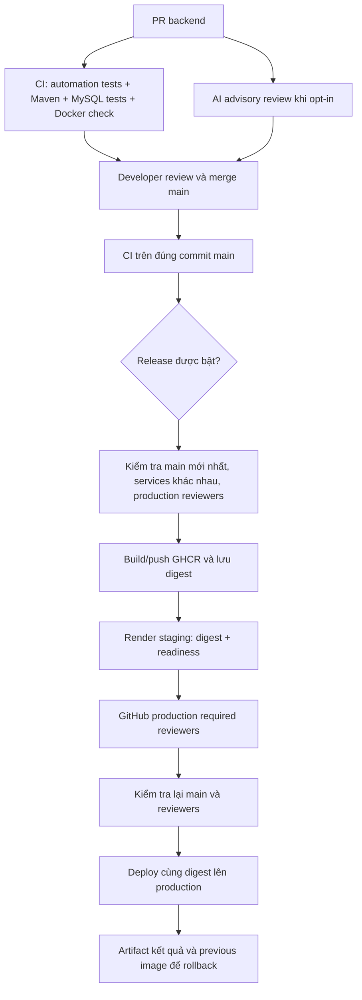

# Phát hành, staging, production và rollback

Source đã được chuẩn bị; chưa publish GHCR, gọi Render API, tạo service, cấu hình
GitHub settings hay deploy thật. Không dùng tài liệu này như bằng chứng production.

## Luồng và cổng kiểm soát



CI chỉ gọi reusable release sau khi cả job `build` và `docker-build-check` pass
trên push `main`. PR không gọi release. Không chạy verify lặp lại trong một
workflow release tự động khác. AI review không có quyền merge/deploy.

## Cấu hình cần chủ repo/dịch vụ thực hiện

| Nơi cấu hình | Tên | Ý nghĩa |
|---|---|---|
| Repository variable | `CINEGO_RELEASE_ENABLED` | Mặc định chưa đặt/false; chỉ đặt true khi được phép phát hành thật |
| Repository variable | `RENDER_STAGING_SERVICE_ID` | Service image-backed cho staging |
| Repository variable | `RENDER_PRODUCTION_SERVICE_ID` | Service khác dành cho production |
| GitHub environment `staging` | Secret `RENDER_API_KEY`, variable `HEALTH_URL` | Key do chủ dịch vụ cấu hình; URL readiness native của staging |
| GitHub environment `production` | Secret `RENDER_API_KEY`, variable `HEALTH_URL` | Key/URL production riêng theo quyền tài khoản |
| GitHub environment `production` | Required reviewers | Bắt buộc có ít nhất một reviewer; workflow kiểm tra qua API trước publish và sau approval |
| GitHub repo | Branch protection/ruleset | Review và các CI checks bắt buộc cho main; không tự thay settings |
| GHCR | `ghcr.io/<owner>/cinego-be` | Cho phép workflow push và Render pull; giữ image đã phát hành để rollback |

Không cần PAT để workflow publish trong repo nếu `GITHUB_TOKEN` có `packages:write`
và package policy cho phép. Render cần public package hoặc registry credential
được cấu hình trong tài khoản Render. Không truyền registry key qua prompt.
Tên owner được chuyển lowercase; staging/prod phải cấu hình cùng repository image.

Không chỉ tạo environment tên `production`: phải có required reviewers thật.
Nếu GitHub plan/repo visibility không hỗ trợ rule đó, preflight sẽ fail; không
bỏ kiểm tra để gọi luồng này là production gate. Quyền đọc environment dùng
`actions:read`; nếu API trả 403, xử lý quyền/gói tài khoản trước khi phát hành.

## Thứ tự bootstrap

1. Review source, commit/push/merge khi được phép. Giữ AI/release opt-in tắt.
2. Rotate/revoke credential mail/JWT từng dùng thật. Xóa giá trị khỏi file hiện
   tại không xóa lịch sử Git, logs, artifacts hoặc image cũ. Không tự rewrite history.
3. Chuẩn bị MySQL schema có sẵn, Redis, Kafka và HBase/ZooKeeper có thể truy cập
   từ Render; dữ liệu staging tách production. Không dùng localhost cho dịch vụ từ xa.
4. Sau khi được phép publish bootstrap artifact: test/build source main, đăng
   nhập GHCR trong terminal bằng credential của chủ repo, tag/push image đầu tiên
   theo các lệnh dưới. Bước này chưa được thực thi trong phiên làm việc.
5. Tạo hai Render image-backed web services từ image bootstrap. Tắt auto-deploy,
   đặt health check `/actuator/health/readiness`, cấu hình registry pull access.
6. Đặt runtime env theo `.env.example`, GitHub environments/secrets/variables và
   required reviewers. Không dùng cùng service ID hoặc DB cho staging/production.
7. Chỉ bật `CINEGO_RELEASE_ENABLED=true` sau khi chủ repo chấp thuận phát hành.
8. Tạo thay đổi được review, merge main, theo dõi CI → staging → production approval.

Ví dụ bootstrap cho chủ repo thực hiện SAU khi được duyệt publish:

```sh
./mvnw -B -ntp -pl cine-be -am verify
docker build -f cine-be/Dockerfile.production -t cinego-be:bootstrap .
# docker login ghcr.io trong terminal; không ghi token vào command/file source
docker tag cinego-be:bootstrap ghcr.io/phamlinh296/cinego-be:bootstrap
docker push ghcr.io/phamlinh296/cinego-be:bootstrap
```

## Runtime và readiness

Image production mặc định bật profile `prod`. Profile yêu cầu các biến cấu hình
trong `.env.example`; JVM không còn dùng JWT/mail password fallback cũ. Tạo key
JWT đủ mạnh trong công cụ quản lý secret, không chia sẻ qua chat.

- `ddl-auto=validate`, SQL init tắt: ứng dụng không tự sửa schema. Provision/
  migration/backup là công việc riêng cần duyệt. Schema lệch sẽ làm startup fail.
- Readiness public GET chỉ trả status, kiểm tra Spring readiness state, MySQL
  và Redis. Liveness kiểm tra trạng thái sống của app.
- Readiness chưa kiểm tra toàn bộ luồng Kafka/HBase/payment. Cần smoke nghiệp vụ
  trên dữ liệu staging trước khi duyệt production; HTTP UP không chứng minh mọi tính năng.
- Các actuator endpoint khác không được mở public. Quyền API nghiệp vụ cũ chưa
  được thiết kế lại; cần security review riêng trước môi trường có dữ liệu thật.
- Redis mặc định TLS ở prod; nếu dùng mạng nội bộ không TLS phải cấu hình rõ
  `REDIS_SSL_ENABLED=false` sau khi kiểm tra kiến trúc. Kafka/HBase credentials,
  TLS/network policy và mail delivery phụ thuộc hạ tầng thực tế.

## Script Render và chế độ không deploy

`cine-be/automation/render_deploy.py` dùng stdlib. Không có `--execute` thì chỉ
validate cấu hình, không gọi API, không cần API key. `IMAGE_REF` và
`EXPECTED_IMAGE_REPOSITORY` phải khớp, dùng digest đầy đủ thay vì mutable tag.

Khi chạy thật, script kiểm tra service đúng ID, image-backed, không suspended,
auto-deploy=no, image repository và health URL/healthCheckPath đúng service.
Chỉ gửi key đến API Render cố định, không gửi key đến health URL và không theo redirect.

Sau POST, script đợi deploy ID cụ thể thành live, kiểm tra resolved image SHA và
đòi HTTP 200 JSON `status=UP`. GET có retry giới hạn khi 429/5xx; POST không tự
retry vì timeout có thể xảy ra sau khi Render đã nhận yêu cầu.

Nếu POST timeout: kiểm tra dashboard/deploy list trước khi chạy lại, tránh tạo
deploy trùng. Khi fail sau POST, artifact vẫn lưu deploy ID/previous image nếu đã có.

## Production approval và cạnh tranh giữa các release

Workflow release và rollback dùng chung concurrency group, không cancel run
đang deploy. Main CI không auto-cancel; PR CI vẫn cancel run cũ. GitHub concurrency
không đảm bảo FIFO và có thể thay pending run bằng run mới hơn.

Preflight từ chối main commit cũ. Sau khi chờ approval, production kiểm tra lại
main và reviewers; nếu main đã đổi, dừng release đó để bản mới được kiểm thử.
Không build lại image cho production: dùng output digest của publish đã qua staging.

Concurrency chỉ bao phủ workflow này. Người thao tác Render dashboard/API khác
cần phối hợp; Render API không cung cấp compare-and-swap nguyên tử cho toàn luồng.

## Rollback và diễn tập staging

1. Lưu artifact `staging-release-*` / `production-release-*`: chứa image digest,
   previous digest, service ID, deploy ID và smoke status, không chứa API key.
2. Chọn digest tốt đã kiểm chứng trong evidence; giữ image trong GHCR. Nếu đây
   là deploy đầu tiên thì có thể không có previous digest để rollback.
3. Trước production, diễn tập trên staging bằng workflow `Backend rollback`:
   chọn `environment=staging`, `image_ref` là digest tốt trước đó,
   `expected_current_image` là digest đang live.
4. Workflow kiểm tra main/opt-in, image repository và môi trường; script kiểm
   tra lại current live digest trước POST. Nếu current thay đổi, từ chối thao tác.
5. Đợi live, resolved SHA và readiness UP; lưu artifact rollback, chạy smoke nghiệp vụ.
6. Khi cần rollback production, chọn `production`; required reviewers và kiểm
   tra sau approval vẫn áp dụng. Đây là thao tác phục hồi có phê duyệt, không tự động.

Không giả định rollback image sẽ rollback database/data hoặc event đã phát.
Chưa có migration tự động; cần backward compatibility và backup được kiểm tra.
Diễn tập bằng unittest HTTP giả lập chưa thay thế diễn tập staging thật.

## Evidence và điều kiện hoàn thành

| Bằng chứng | Trạng thái hiện tại |
|---|---|
| Backend tests + MySQL + health/security tests | Đã chạy local, xem DELIVERY-STATUS.md |
| Helper AI/release/rollback tests và YAML lint | Đã chạy local |
| PR thật nhận AI review | Chưa chạy; cần publish source, opt-in, model/key và duyệt chi phí |
| GHCR release digest | Chưa publish |
| Render staging/prod/rollback exercise | Chưa chạy; cần account services/config/approval |
| Áp dụng nhóm/bộ phận/công ty | Chưa có bằng chứng adoption |

Khi có run thật, bổ sung run/PR URL, head SHA, digest, reviewer và kết quả smoke;
không tự tạo link minh chứng hoặc ghi đã vận hành production.

Nguồn: [Render create deploy](https://api-docs.render.com/reference/create-deploy),
[retrieve deploy](https://api-docs.render.com/reference/retrieve-deploy),
[GitHub environment API](https://docs.github.com/en/rest/deployments/environments),
[Spring Boot probes](https://docs.spring.io/spring-boot/3.3/reference/actuator/endpoints.html).
